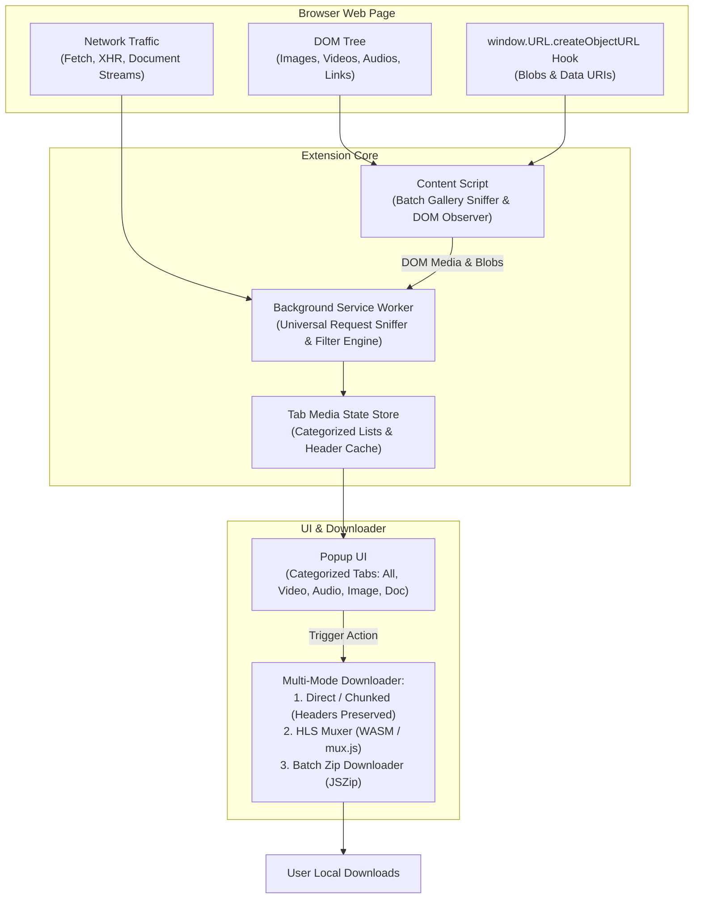

# Implementation Plan: Universal Multi-Type Downloader Browser Extension

This plan outlines the complete roadmap to extract Soul Browser's universal file & media extraction architecture and build a high-performance, cross-platform PC browser extension (Chrome, Edge, Firefox, Brave).

---

## 1. System Scope: Supported File & Media Types

Rather than handling only video, the extension adopts Soul Browser's universal classification engine:

| Category | Detected Formats & MIME Types | Detection Mechanism |
| :--- | :--- | :--- |
| **Video & Streams** | `.mp4`, `.webm`, `.m3u8` (HLS), `.mpd` (DASH), `.ts`, `.m4s`, `.mkv`, `video/*` | Network sniffer + HTML5 `<video>` / MSE hooks |
| **Audio & Podcasts** | `.mp3`, `.m4a`, `.aac`, `.flac`, `.wav`, `.ogg`, `.opus`, `audio/*` | Network sniffer + HTML5 `<audio>` tags |
| **Images & Galleries** | `.jpg`, `.jpeg`, `.png`, `.webp`, `.gif`, `.svg`, `data:image/*`, `blob:` | DOM Gallery scanner (``, `picture`, CSS `url()`, canvas) |
| **Documents & eBooks** | `.pdf`, `.epub`, `.mobi`, `.docx`, `.xlsx`, `.csv`, `application/pdf` | `Content-Type`, `Content-Disposition`, file extensions |
| **Archives & Packages** | `.zip`, `.rar`, `.7z`, `.tar.gz`, `.apk`, `.exe`, `.dmg`, `.iso` | Network header inspection (`application/octet-stream`, `attachment`) |
| **Blob & Dynamic Data** | In-memory `blob:...` URIs generated by Canvas, Workers, or PDF viewers | Content script Blob URL registry hook |

---

## 2. Architecture Overview



---

## 3. Implementation Phases & Milestones

### Phase 1: Reverse Engineering & Extraction from Soul Browser
* [ ] **Decompile Universal Interceptors**:
  * Extract `WebViewActivity.L0` & `WebViewActivity.b6` (Universal `DownloadListener` handling direct URLs, `blob:` URLs, and `data:image/` URLs).
  * Extract `WebClean` and MIME classification dictionaries from `soul_browser.apk`.
  * Extract Soul Browser's Album/Batch Image Collector algorithms.
* [ ] **Catalog Header Forwarding Logic**:
  * Document exact rules for forwarding `Referer`, `Cookie`, `User-Agent`, and `Origin` to prevent `403 Forbidden` on protected CDNs.

---

### Phase 2: Manifest V3 Extension Scaffolding
* [ ] **Directory Layout**:
  ```text
  Downloader_Extension/
  ├── manifest.json                  # Manifest V3 with MV2/Firefox compatibility
  ├── background/
  │   ├── service_worker.js          # Core coordinator
  │   ├── network_sniffer.js         # webRequest & header inspector
  │   └── classifier.js              # MIME and extension rule engine
  ├── content/
  │   ├── dom_scanner.js             # High-res image, audio & video DOM crawler
  │   └── inject_hook.js             # Blob URL, fetch & XHR monkey-patches
  ├── popup/
  │   ├── popup.html                 # Categorized dashboard (Tabs: Videos, Images, Audio, Files)
  │   ├── popup.css                  # Modern UI styling
  │   └── popup.js                   # Filtering, previews, and download actions
  ├── offscreen/
  │   ├── offscreen.html             # High-compute sandbox (HLS / Zip)
  │   ├── hls_stream_muxer.js        # HLS m3u8 segmenter & MP4 remuxer
  │   └── batch_packager.js          # JSZip batch image/file packager
  └── lib/
      ├── mux.js                     # In-browser MP4 container muxer
      └── jszip.min.js               # Multi-image ZIP bundling
  ```
* [ ] **Manifest Permissions**:
  * `webRequest`, `downloads`, `storage`, `activeTab`, `scripting`, `offscreen`, `<all_urls>`.

---

### Phase 3: Universal Sniffing Engine
* [ ] **Network Request Sniffer (`background/network_sniffer.js`)**:
  * Inspect `onHeadersReceived` for `Content-Type` headers:
    * Videos (`video/*`, `.m3u8`, `.mpd`)
    * Audio (`audio/*`, podcasts)
    * Documents (`application/pdf`, office formats)
    * Archives & Binaries (`application/zip`, `application/octet-stream`, `Content-Disposition: attachment`)
  * Record file size (`Content-Length`) and session headers (`Referer`, `Origin`, cookies).
* [ ] **Batch Image & Asset DOM Crawler (`content/dom_scanner.js`)**:
  * Scan for `` (resolving `srcset` and `data-src` lazy-loading attributes).
  * Scan CSS `background-image: url(...)` styles.
  * Extract image dimensions to filter out tiny tracking pixels, icons, and UI avatars.
* [ ] **Dynamic & Blob Interceptor (`content/inject_hook.js`)**:
  * Intercept `URL.createObjectURL` to catch dynamic Blob downloads (e.g. client-side generated PDFs, cropped images, web-app downloads).

---

### Phase 4: Download & Processing Pipelines
* [ ] **Direct & Authenticated File Downloads**:
  * For standard files (`.pdf`, `.zip`, `.apk`, `.mp4`, `.mp3`):
    * Trigger `chrome.downloads.download` with preserved `Referer` and cookie contexts.
* [ ] **HLS Video Streaming Engine (`offscreen/hls_stream_muxer.js`)**:
  * Multi-threaded fetching of `.ts` chunks with automatic retry on network drops.
  * Remux `.ts` packets into `.mp4` using `mux.js` without transcoding quality loss.
* [ ] **Batch Gallery / Multi-File Downloader (`offscreen/batch_packager.js`)**:
  * Allow "Select All" / "Select Filtered" for gallery images or documents.
  * Concurrent download of selected items and bundle into a single `.zip` file for 1-click archiving.

---

### Phase 5: Categorized Popup Dashboard
* [ ] **Tabbed Interface**:
  * 🎬 **Videos** (resolution, bitrate, format, duration estimate)
  * 🎵 **Audio** (bitrate, format, title)
  * 🖼️ **Images** (grid view with thumbnails, dimensions, select all / download zip)
  * 📁 **Documents & Files** (file extension badge, byte size)
* [ ] **Batch Operations**:
  * "Download Selected" button.
  * "Copy URLs" button.
  * Search/filter bar within the popup.
* [ ] **Extension Badge Counter**:
  * Displays total detected items on current tab (e.g., `12` or colored indicator).

---

### Phase 6: Cross-Browser Packaging & Testing
* [ ] **Testing against real-world test sites**:
  * Media streams (HLS, DASH, direct MP4/WebM).
  * Image galleries (Pinterest, ArtStation, Flickr, e-commerce product pages).
  * Direct downloads (GitHub releases, Google Drive direct links, PDF reports).
* [ ] **Browser Compatibility Testing**:
  * Chrome, Edge, Brave, and Opera.
  * Firefox compatibility check (`browser.*` namespace polyfill).
