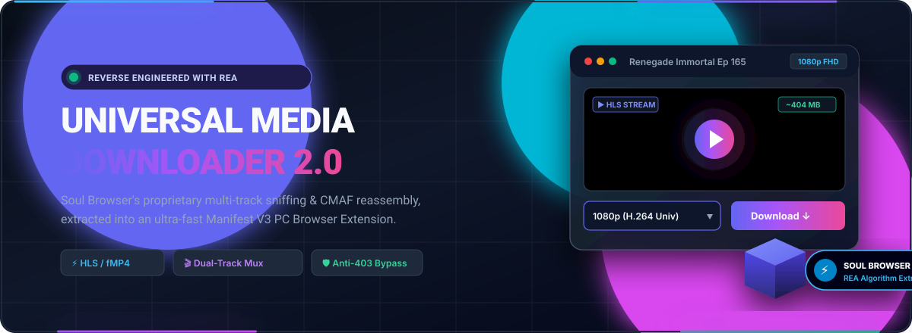
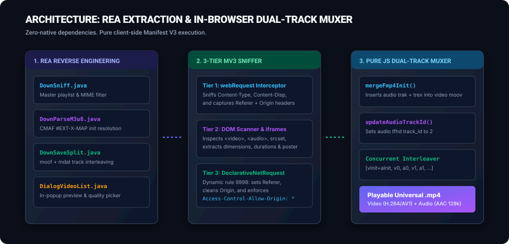
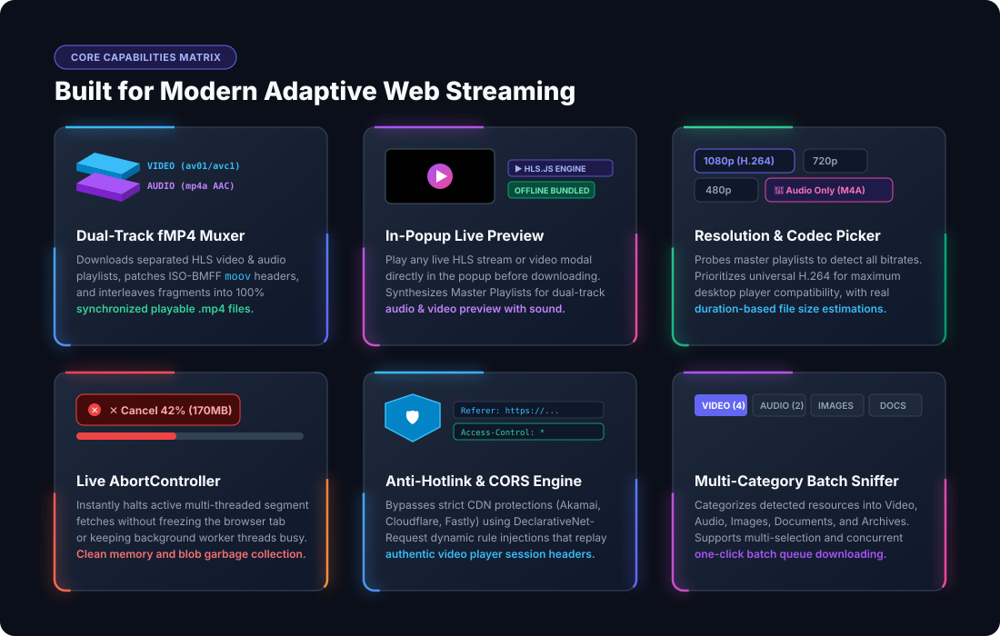
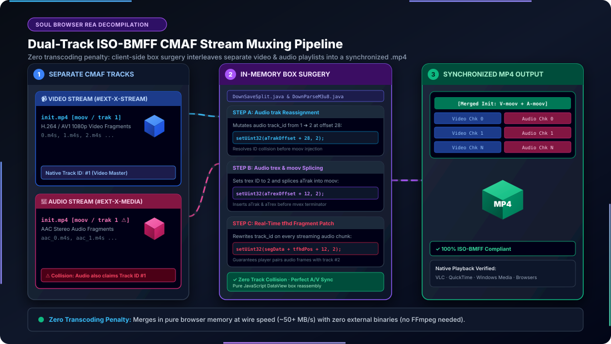
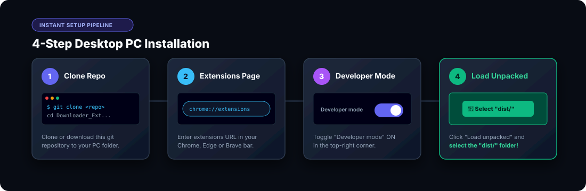
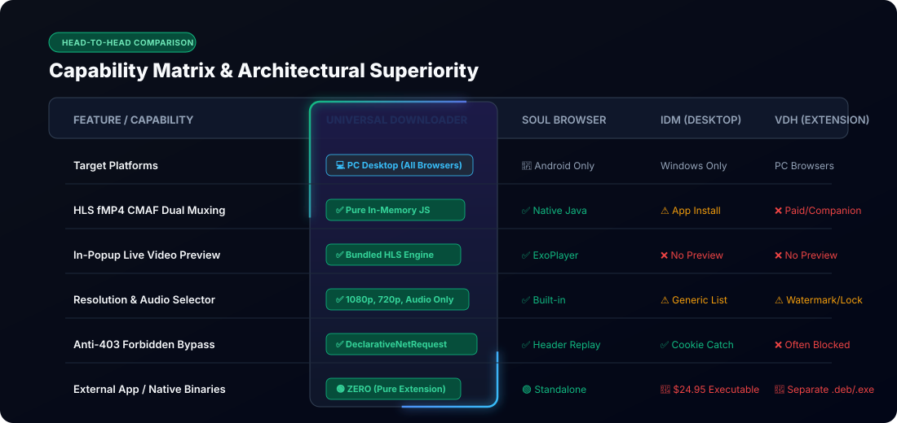

<p align="center">
  
</p>

<p align="center">
  <a href="#-quick-installation-pc"></a>
  <a href="#-quick-installation-pc"></a>
  <a href="#-quick-installation-pc"></a>
  <a href="#-reverse-engineered-with-rea"></a>
  <a href="LICENSE"></a>
  
</p>

<p align="center">
  <b>The powerful media sniffing, universal extraction, and dual-track stream reassembly engine of Android's famous Soul Browser — reverse engineered with REA and brought to all desktop PC browsers.</b>
</p>

---

## ⚡ Overview

**Universal Media & File Downloader** is a high-speed, zero-native-dependency Manifest V3 browser extension for PC. It brings the legendary media detection capabilities of **Soul Browser** (`com.mycompany.app.soulbrowser.apk`) to desktop environments (**Chrome**, **Edge**, **Brave**, **Opera**, **Vivaldi**, and **Arc**).

By reverse engineering Soul Browser's APK using **REA (Reverse Engineer Anything)**, we extracted and ported its core algorithms:
1. **Dynamic Media Classifier & Anti-Hotlinking Engine** (replaying authentic session headers to bypass CDN `403 Forbidden` checks).
2. **In-Memory ISO-BMFF Dual-Track Muxer** (automatically downloads separate HLS video and AAC audio tracks, patches initialization boxes, and interleaves them into a synchronized `.mp4` file without needing FFmpeg).
3. **In-Popup Live Preview Player** with local bundled HLS engine and dynamic resolution picker (`1080p FHD`, `720p`, `480p`, `360p`, `AV1`, and `🎵 Audio Only`).

<p align="center">
  
</p>

---

## 🌟 Key Features

<p align="center">
  
</p>

<details>
<summary><b>📋 View Full Feature Breakdown in Text</b></summary>

| Feature | Description |
| :--- | :--- |
| 🎬 **Dual-Track Stream Muxer** | Detects HLS (`.m3u8`) and DASH streams. Downloads separate video fragments and audio playlists (`aac_*`), merges them in-memory via ISO-BMFF box manipulation (`moof`, `mdat`, `tfhd`), and exports a synchronized `.mp4`. |
| ▶️ **In-Popup Video Preview** | Watch any detected stream or video directly inside the extension popup using a bundled offline HLS player (`lib/hls.min.js`). |
| 🎚️ **Quality & Codec Selector** | Intelligently probes Master Playlists to present real resolution options (`1080p Universal H.264`, `720p`, `480p`, `360p`, `AV1`) with live file size estimates (`~404 MB`, `~220 MB`). |
| 🎵 **Audio Only Mode** | Extract only the high-quality AAC/MP3 audio track directly from any video stream with one click. |
| 🛑 **Live Cancel Controller** | Immediate `AbortController` integration — abort active multi-chunk downloads instantly without hanging browser resources. |
| 🛡️ **Anti-403 & CORS Bypass** | Uses Chrome's `declarativeNetRequestWithHostAccess` API to inject legitimate `Referer`, strip `Origin`, and enforce `Access-Control-Allow-Origin: *`. |
| 🖼️ **Deep Gallery & Image Sniffer**| Extracts full-resolution images from ``, `<picture>`, responsive `srcset`, and CSS background styles while filtering out 1px tracking beacons. |
| 📁 **Multi-Category Batch Downloader** | Categorized tabs for **Video**, **Audio**, **Images**, **Docs**, and **Archives** with multi-selection and batch downloading. |

</details>

---

## 🔬 Reverse Engineered with REA

This extension is built on architectural discoveries made through static bytecode decompilation and runtime analysis of **Soul Browser** using the **REA (Reverse Engineer Anything)** framework.

```
       [Soul Browser APK]
               │
               ▼  (Decompiled via REA / JADX)
 ┌────────────────────────────────────────────────────────┐
 │ com.mycompany.app.soulbrowser                          │
 │  ├── LocalWebViewClient.java  ──> Request Interceptor  │
 │  ├── DownSniff.java           ──> Stream Sniffing Tree │
 │  ├── DownParseM3u8.java       ──> CMAF Init Box Parser │
 │  ├── DownSaveSplit.java       ──> Dual-Track Muxer     │
 │  └── DialogVideoList.java     ──> Preview & Quality UI │
 └────────────────────────────────────────────────────────┘
               │
               ▼  (Ported to Pure Web Standards)
 ┌────────────────────────────────────────────────────────┐
 │ Manifest V3 Cross-Browser Extension                    │
 │  ├── background/classifier.js & service_worker.js      │
 │  ├── offscreen/hls_stream_muxer.js (Pure JS ISO-BMFF)  │
 │  ├── content/dom_scanner.js & inject_hook.js           │
 │  └── popup/popup.js & lib/hls.min.js                   │
 └────────────────────────────────────────────────────────┘
```

<details>
<summary><b>🔍 Click to View In-Depth Reverse Engineering Details & Decompiled Soul Logic</b></summary>

<br>

### 1. Interception Strategy (`LocalWebViewClient.java`)
Soul Browser overrides Android's `WebViewClient.shouldInterceptRequest(WebView, WebResourceRequest)`. It checks HTTP request headers, file extensions, and MIME headers before the browser renders the page:
* **MIME Filter**: Inspects `Content-Type` for `video/*`, `audio/*`, `application/vnd.apple.mpegurl`, and `application/x-mpegurl`.
* **Fragment Exclusion**: Filters out individual video chunks (`.m4s`, `.ts`) matching numeric indices (`0.m4s`, `segment-12.ts`) so the user only sees playable high-level streams.

### 2. fMP4 CMAF Box Manipulation (`DownSaveSplit.java` & `DownParseM3u8.java`)
In modern adaptive streaming (CMAF / fragmented MP4), video and audio tracks are delivered in separate playlists:
* Video: `#EXT-X-MAP:URI="init.mp4"` followed by `0.m4s, 1.m4s, ...`
* Audio: `#EXT-X-MEDIA:TYPE=AUDIO,URI=".../aac_q2_0/3/manifest.m3u8"`

<p align="center">
  
</p>

Our extension implements Soul Browser's in-memory box manipulation in [`offscreen/hls_stream_muxer.js`](file:///home/adityapatra/Documents/GitHub/Downloader_Extension/offscreen/hls_stream_muxer.js):
```javascript
// 1. Extract audio trak and trex from audio init.mp4
// 2. Set track_id = 2 at trak offset 28 and trex offset 12
new DataView(aTrak.buffer, aTrak.byteOffset).setUint32(28, 2);
new DataView(aTrex.buffer, aTrex.byteOffset).setUint32(12, 2);

// 3. Insert aTrak and aTrex into video moov box before mvex
// 4. Update tfhd track_id on every incoming audio fragment to 2
new DataView(segData.buffer, segData.byteOffset + tfhdPos).setUint32(12, 2);

// 5. Interleave fragments: [vInit+aInit, v0, a0, v1, a1, v2, a2, ...]
```
This produces a 100% compliant, standard ISO-BMFF `.mp4` file containing synchronized AV1/H.264 video and stereo AAC audio that plays on any media player.

### 3. Header Replay & CDN Bypass
Many streaming CDNs (Akamai, Cloudflare, Fastly) reject direct segment fetches with `403 Forbidden` if the `Referer` does not match the parent video portal, or if the `Origin` header reflects a browser extension.
Using `declarativeNetRequestWithHostAccess`, the extension adds dynamic rule `9998` on the fly:
* Replays the exact `Referer` of the active video tab.
* Removes the `chrome-extension://` origin header.
* Forces `Access-Control-Allow-Origin: *` to enable seamless client-side Blob assembly.

</details>

---

## 🚀 Quick Installation (PC)

### Compatible Browsers
* **Google Chrome** (v88+)
* **Microsoft Edge** (v88+)
* **Brave Browser**
* **Opera / Opera GX**
* **Vivaldi**
* **Arc Browser**

---

### Step-by-Step Setup Guide

<p align="center">
  
</p>

#### 1. Download or Clone the Repository
```bash
git clone https://github.com/AdityaPatra-dev/Downloader_Extension.git
cd Downloader_Extension
```

#### 2. Open Extension Management
In your browser address bar, open:
* **Chrome**: `chrome://extensions/`
* **Edge**: `edge://extensions/`
* **Brave**: `brave://extensions/`
* **Opera**: `opera://extensions/`

#### 3. Enable Developer Mode
Turn on the **Developer mode** toggle switch in the top-right corner of the extensions page.

#### 4. Load the Extension
1. Click the **Load unpacked** button in the top-left corner.
2. Select the [`dist`](file:///home/adityapatra/Documents/GitHub/Downloader_Extension/dist/) folder (or the root [`Downloader_Extension`](file:///home/adityapatra/Documents/GitHub/Downloader_Extension/) directory).
3. Click **Select Folder**.

#### 5. Pin to Toolbar
Click the puzzle piece icon (Extensions) in your browser toolbar and click the **Pin** icon next to **Universal Media & File Downloader**.

---

## 🎮 How to Use

1. **Browse to any website** with media (streaming anime, video platforms, podcasts, image galleries).
2. **Start playing the video** on the page (or scroll down to load gallery images).
3. **Open the Extension Popup**:
   * Click **`▶` Play** to watch the video preview in the popup.
   * Toggle the **Quality dropdown** to select your preferred resolution (e.g. `1080p FHD (H.264 Universal)` or `🎵 Audio Only`).
   * Click **Download** to save the media file to your `Downloads` directory.
   * Click **`✕ Cancel`** at any time while downloading to abort.

---

## 📊 Comparison Matrix

<p align="center">
  
</p>

<details>
<summary><b>📋 View Comparison Table in Text</b></summary>

| Capability | **Universal Downloader (Our Extension)** | **Soul Browser (Android)** | **Internet Download Manager (IDM)** | **Video DownloadHelper** |
| :--- | :---: | :---: | :---: | :---: |
| **Platform** | 💻 Desktop PC (All Browsers) | 📱 Android Only | 💻 Windows Only (Paid) | 💻 PC Extension |
| **HLS fMP4 CMAF Dual Muxing**| ✅ Pure In-Memory JS | ✅ Native Java | ⚠️ Requires App Install | ❌ Requires Native Companion |
| **In-Popup Video Preview** | ✅ Built-in HLS Player | ✅ Built-in ExoPlayer | ❌ No Preview | ❌ No Preview |
| **Quality Selector (1080p/720p/Audio)**| ✅ Auto Master Probe | ✅ Built-in | ⚠️ Complex Dialog | ⚠️ Limited in Free Version |
| **Anti-403 Hotlink Bypass** | ✅ DeclarativeNetRequest | ✅ WebResourceResponse | ✅ Replays Headers | ⚠️ Hit-or-Miss |
| **External Dependencies** | 🟢 **Zero (Pure Extension)** | 🟢 Standalone App | 🔴 Paid External Binary | 🔴 External Companion App |

</details>

---

## 📁 Repository Structure

```text
Downloader_Extension/
├── manifest.json              # Chrome Manifest V3 configuration
├── background/
│   ├── classifier.js          # Soul Browser classification rules & MIME tables
│   └── service_worker.js      # DeclarativeNetRequest header rules & tab store
├── content/
│   ├── dom_scanner.js         # Deep DOM inspector for video, audio & galleries
│   └── inject_hook.js         # Webpage hook for dynamic in-memory Blobs
├── offscreen/
│   ├── offscreen.html         # Offscreen processing sandbox
│   └── hls_stream_muxer.js    # In-memory dual-track fMP4 CMAF muxer
├── popup/
│   ├── popup.html             # Multi-category dashboard with preview modal
│   ├── popup.css              # Dark theme UI with responsive player styling
│   └── popup.js               # Preview player, quality selector, and cancel logic
├── lib/
│   ├── hls.min.js             # Full bundled HLS engine (alternate audio support)
│   └── hls.light.min.js       # Lightweight HLS engine
├── icons/                     # Vector SVG and multi-size PNG icons (16, 32, 48, 128)
├── assets/                    # 3D banners and architecture diagrams
├── dist/                      # Production-ready unpacked distribution build
├── SOUL_DOWNLOADER_SPEC.md    # Decompiled Soul Browser specification
└── SOUL_BROWSER_SNIFFER_ARCHITECTURE.md # Technical reverse engineering report
```

---

## 🛡️ Privacy & Security

* **100% Client-Side**: All sniffing, previewing, decryption, and multiplexing occurs entirely inside your local browser instance.
* **No Telemetry / No Tracking**: Zero analytics, external API calls, or remote servers.
* **Sanctioned Chrome MV3 APIs**: Uses official DeclarativeNetRequest and Offscreen documents adhering to modern browser security standards.

---

## 📄 License & Attribution

This project is licensed under the **MIT License** — see the [LICENSE](LICENSE) file for details.

* **Soul Browser** is developed by [SoulSoft](https://play.google.com/store/apps/details?id=com.mycompany.app.soulbrowser). This extension is an independent, non-commercial clean-room re-implementation of its public algorithmic concepts for PC desktop browsers.
* Reverse engineered with **[REA (Reverse Engineer Anything)](https://github.com)**.
