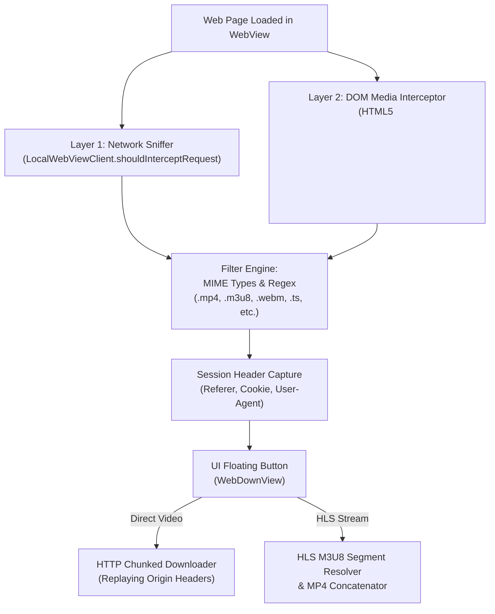
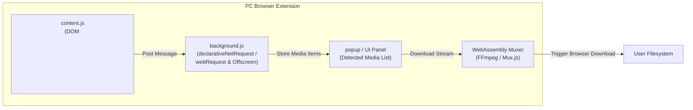

# Soul Browser Media Downloader: Reverse Engineering & PC Extension Architecture

This document breaks down the reverse engineering of Soul Browser's media sniffing and download system using **REA (Reverse Engineer Anything)**, and outlines how to port its core functionality into a cross-browser extension for PC.

---

## 1. Feasibility Assessment: Is This Possible with REA?

**Yes.** REA provides the exact tooling required to deconstruct, trace, and extract the logic:

* **Static DEX & Java Analysis (`rea inspect-android-package`, `rea search-android-classes`, JADX)**:
  Exposes the class structure, decompiles the bytecode to readable Java, and reveals the regex patterns, MIME filters, and header replay logic.
* **Component & Call Site Tracing (`rea trace-android-references`, `rea xrefs`)**:
  Traces where media URLs detected in the browser view are dispatched to the download manager and HLS stream segmenter.
* **Resource & Config Extraction (`rea decode-android-resources`)**:
  Decodes string tables, filter lists, and configuration assets.
* **Live Dynamic Observation (`adb`, `rea read-adb-logcat`)**:
  Allows observing the media detector firing on live sites in the emulator in real time.

---

## 2. Reverse Engineering the Mechanism in Soul Browser

By decompiling `soul_browser.apk`, we identify that the "Download Anything" feature consists of **four distinct subsystems**:



### A. Layer 1: Network Sniffing (`LocalWebViewClient.shouldInterceptRequest`)
Located inside `com.mycompany.app.web.WebViewActivity.LocalWebViewClient`:
* In Android's Chromium WebView, every HTTP/HTTPS asset request (scripts, images, media segments, XHR, fetch) triggers `shouldInterceptRequest(WebView view, WebResourceRequest request)`.
* Soul Browser extracts `request.getUrl()`, inspects query parameters, and inspects file extension suffixes (`.mp4`, `.m3u8`, `.flv`, `.webm`, `.avi`, `.ts`, etc.).
* It also evaluates `Accept` and `Content-Type` headers to capture media streams that lack standard file extensions in their URL.

### B. Layer 2: DOM & JavaScript Injection
* Soul Browser injects custom scripts into web pages via `evaluateJavascript`.
* These scripts intercept:
  1. Mutation observers looking for newly inserted `<video>` and `<audio>` tags.
  2. `HTMLMediaElement.prototype.play` and `src` getters/setters.
  3. `window.fetch` and `XMLHttpRequest.prototype.open` to capture manifest URLs loaded by custom web players (Video.js, JW Player, Plyr).

### C. Layer 3: Header Preservation & Anti-Hotlinking
Many CDNs return `403 Forbidden` if media files are fetched without valid session credentials. Soul Browser preserves:
* `Referer` (the page origin hosting the media)
* `User-Agent`
* `Cookie` headers
When the download starts, it replays these exact headers to ensure the CDN authorizes the request.

### D. Layer 4: HLS (`.m3u8`) Parsing & Concatenation
When an `.m3u8` playlist is captured:
1. The parser fetches the master playlist and selects the highest resolution stream.
2. It downloads the target variant playlist containing `.ts` chunks.
3. It downloads all `.ts` segments asynchronously using multi-threading.
4. It concatenates the segments sequentially and repacks them into an `.mp4` container.

---

## 3. Step-by-Step Procedure to Inspect & Extract via REA

You can run these commands directly on the host using the installed REA toolchain:

### Step 1: Trace Web Media Classes
```bash
rea search-android-classes soul_browser.apk "com.mycompany.app.web.WebVideo"
rea search-android-classes soul_browser.apk "com.mycompany.app.wview.WebDown"
```

### Step 2: Inspect the Download View & Sniffer Methods
```bash
# Decompile the WebView Activity where request interception occurs
jadx -d /tmp/soul_src --single-class "com.mycompany.app.web.WebViewActivity" soul_browser.apk

# Search for the m3u8 and video filter patterns
grep -n -C 5 "\.m3u8" /tmp/soul_src/sources/com/mycompany/app/web/WebViewActivity.java
```

### Step 3: Inspect the Floating Download UI Trigger
```bash
# See how detected URLs are passed to the download task
jadx -d /tmp/soul_src --single-class "com.mycompany.app.wview.WebDownView" soul_browser.apk
```

### Step 4: Live Verification on Emulator
Launch the app in the emulator and monitor logs while playing a video on any website:
```bash
adb logcat -v time | grep -iE "video|download|m3u8|mp4"
```

---

## 4. Designing the PC Browser Extension (Architecture Blueprint)

Because PC browsers (Chrome, Edge, Firefox, Brave) do not allow native Android APKs to run directly, the correct approach is to implement Soul Browser's architecture as a **Manifest V3 Web Extension**.



### Component Breakdown for PC:

#### 1. Background Service Worker (`background.js`)
* Uses `chrome.webRequest.onHeadersReceived` or `chrome.declarativeNetRequest` to capture network traffic across all tabs.
* Filters for response headers:
  * `Content-Type: video/*`
  * `Content-Type: application/vnd.apple.mpegurl` (HLS `.m3u8`)
  * `Content-Type: application/dash+xml` (DASH `.mpd`)
  * Suffix matches for `.mp4`, `.webm`, `.ts`, `.m4s`.
* Captures the request's `initiator` / `Referer` and tab cookies.

#### 2. Content Script (`content.js`)
* Injected into every page at `document_start`.
* Scans for HTML5 video elements:
  ```javascript
  document.querySelectorAll('video, audio').forEach(el => {
    if (el.src) notifyBackground(el.src);
    el.querySelectorAll('source').forEach(s => notifyBackground(s.src));
  });
  ```
* Hooks into `MediaSource` and `window.fetch` to intercept player initialization manifests.

#### 3. Stream Assembler (Offscreen Document + WebAssembly)
* For standard `.mp4` / `.webm` files: Triggers `chrome.downloads.download({ url, filename, headers })`.
* For `.m3u8` (HLS) streams:
  * An offscreen document downloads the playlist.
  * Fetches the `.ts` chunks concurrently with browser `fetch()`.
  * Merges the stream chunks using `mux.js` or `@ffmpeg/ffmpeg` (WASM) in-memory.
  * Generates a single local blob and triggers a browser download.

---

## 5. Scope & Constraints

* **DRM-Protected Streams (Widevine / FairPlay / PlayReady)**:
  Encrypted streams (e.g. Netflix, Disney+, Prime Video) use hardware/browser CDM encryption. Neither Soul Browser nor standard extensions can decrypt these without DRM violation.
* **CORS & Range Requests**:
  In a PC extension, downloading chunks with matching `Referer` and `Origin` headers requires host permissions (`<all_urls>`) in `manifest.json`.

